# Projects and dependencies analysis

This document provides a comprehensive overview of the projects and their dependencies in the context of upgrading to .NETCoreApp,Version=v8.0.

## Table of Contents

- [Executive Summary](#executive-Summary)
  - [Highlevel Metrics](#highlevel-metrics)
  - [Projects Compatibility](#projects-compatibility)
  - [Package Compatibility](#package-compatibility)
  - [API Compatibility](#api-compatibility)
- [Aggregate NuGet packages details](#aggregate-nuget-packages-details)
- [Top API Migration Challenges](#top-api-migration-challenges)
  - [Technologies and Features](#technologies-and-features)
  - [Most Frequent API Issues](#most-frequent-api-issues)
- [Projects Relationship Graph](#projects-relationship-graph)
- [Project Details](#project-details)

  - [AssetFox.CalculateEvaluate.Testing\AssetFox.CalculateEvaluate.Testing.csproj](#assetfoxcalculateevaluatetestingassetfoxcalculateevaluatetestingcsproj)
  - [AssetFox.CalculateEvaluate\AssetFox.CalculateEvaluate.csproj](#assetfoxcalculateevaluateassetfoxcalculateevaluatecsproj)
  - [AssetFox.Choice\AssetFox.Choice.csproj](#assetfoxchoiceassetfoxchoicecsproj)
  - [AssetFox.Comparison\AssetFox.Comparison.csproj](#assetfoxcomparisonassetfoxcomparisoncsproj)
  - [AssetFox.Core.Analysis.ConsoleApp\AssetFox.Core.Analysis.ConsoleApp.csproj](#assetfoxcoreanalysisconsoleappassetfoxcoreanalysisconsoleappcsproj)
  - [AssetFox.Core.Analysis.Logic.Testing\AssetFox.Core.Analysis.Logic.Testing.csproj](#assetfoxcoreanalysislogictestingassetfoxcoreanalysislogictestingcsproj)
  - [AssetFox.Core.Analysis.Logic\AssetFox.Core.Analysis.Logic.csproj](#assetfoxcoreanalysislogicassetfoxcoreanalysislogiccsproj)
  - [AssetFox.Core.Analysis.Testing\AssetFox.Core.Analysis.Testing.csproj](#assetfoxcoreanalysistestingassetfoxcoreanalysistestingcsproj)
  - [AssetFox.Core.Analysis\AssetFox.Core.Analysis.csproj](#assetfoxcoreanalysisassetfoxcoreanalysiscsproj)
  - [AssetFox.Core.Common\AssetFox.Core.Common.csproj](#assetfoxcorecommonassetfoxcorecommoncsproj)
  - [AssetFox.Core.Data\AssetFox.Core.Data.csproj](#assetfoxcoredataassetfoxcoredatacsproj)
  - [AssetFox.Core.DataPersistenceCore\AssetFox.Core.DataPersistenceCore.csproj](#assetfoxcoredatapersistencecoreassetfoxcoredatapersistencecorecsproj)
  - [AssetFox.Core.DataUnitTests\AssetFox.Core.DataUnitTests.csproj](#assetfoxcoredataunittestsassetfoxcoredataunittestscsproj)
  - [AssetFox.Core.DTOs\AssetFox.Core.DTOs.csproj](#assetfoxcoredtosassetfoxcoredtoscsproj)
  - [AssetFox.Core.ExcelHelpers\AssetFox.Core.ExcelHelpers.csproj](#assetfoxcoreexcelhelpersassetfoxcoreexcelhelperscsproj)
  - [AssetFox.Core.Hubs\AssetFox.Core.Hubs.csproj](#assetfoxcorehubsassetfoxcorehubscsproj)
  - [AssetFox.Core.LongRunningTests\AssetFox.Core.LongRunningTests.csproj](#assetfoxcorelongrunningtestsassetfoxcorelongrunningtestscsproj)
  - [AssetFox.Core.Reporting\AssetFox.Core.Reporting.csproj](#assetfoxcorereportingassetfoxcorereportingcsproj)
  - [AssetFox.Core.TestHelpers\AssetFox.Core.TestHelpers.csproj](#assetfoxcoretesthelpersassetfoxcoretesthelperscsproj)
  - [AssetFox.Core.UnitTestsCore\AssetFox.Core.UnitTestsCore.csproj](#assetfoxcoreunittestscoreassetfoxcoreunittestscorecsproj)
  - [AssetFox.Core.WorkQueue\AssetFox.Core.WorkQueue.csproj](#assetfoxcoreworkqueueassetfoxcoreworkqueuecsproj)
  - [AssetFox.CycleDetection\AssetFox.CycleDetection.csproj](#assetfoxcycledetectionassetfoxcycledetectioncsproj)
  - [AssetFox.Option\AssetFox.Option.csproj](#assetfoxoptionassetfoxoptioncsproj)
  - [AssetFox.Testing\AssetFox.Testing.csproj](#assetfoxtestingassetfoxtestingcsproj)
  - [AssetFox.Validation\AssetFox.Validation.csproj](#assetfoxvalidationassetfoxvalidationcsproj)
  - [AssetFox.Zip\AssetFox.Zip.csproj](#assetfoxzipassetfoxzipcsproj)
  - [AssetFox\AssetFox.csproj](#assetfoxassetfoxcsproj)
  - [AssetFoxCore\AssetFoxCore.csproj](#assetfoxcoreassetfoxcorecsproj)
  - [BridgeCareCoreTests\BridgeCareCoreTests.csproj](#bridgecarecoretestsbridgecarecoretestscsproj)


## Executive Summary

### Highlevel Metrics

| Metric | Count | Status |
| :--- | :---: | :--- |
| Total Projects | 30 | 11 require upgrade |
| Total NuGet Packages | 67 | 5 need upgrade |
| Total Code Files | 1954 |  |
| Total Code Files with Incidents | 18 |  |
| Total Lines of Code | 932377 |  |
| Total Number of Issues | 48 |  |
| Estimated LOC to modify | 31+ | at least 0.0% of codebase |

### Projects Compatibility

| Project | Target Framework | Difficulty | Package Issues | API Issues | Est. LOC Impact | Description |
| :--- | :---: | :---: | :---: | :---: | :---: | :--- |
| [AssetFox.CalculateEvaluate.Testing\AssetFox.CalculateEvaluate.Testing.csproj](#assetfoxcalculateevaluatetestingassetfoxcalculateevaluatetestingcsproj) | net8.0 | ✅ None | 0 | 0 |  | DotNetCoreApp, Sdk Style = True |
| [AssetFox.CalculateEvaluate\AssetFox.CalculateEvaluate.csproj](#assetfoxcalculateevaluateassetfoxcalculateevaluatecsproj) | net6.0 | 🟢 Low | 2 | 2 | 2+ | ClassLibrary, Sdk Style = True |
| [AssetFox.Choice\AssetFox.Choice.csproj](#assetfoxchoiceassetfoxchoicecsproj) | netstandard2.0 | ✅ None | 0 | 0 |  | ClassLibrary, Sdk Style = True |
| [AssetFox.Comparison\AssetFox.Comparison.csproj](#assetfoxcomparisonassetfoxcomparisoncsproj) | netstandard2.0 | 🟢 Low | 1 | 0 |  | ClassLibrary, Sdk Style = True |
| [AssetFox.Core.Analysis.ConsoleApp\AssetFox.Core.Analysis.ConsoleApp.csproj](#assetfoxcoreanalysisconsoleappassetfoxcoreanalysisconsoleappcsproj) | net8.0 | ✅ None | 0 | 0 |  | DotNetCoreApp, Sdk Style = True |
| [AssetFox.Core.Analysis.Logic.Testing\AssetFox.Core.Analysis.Logic.Testing.csproj](#assetfoxcoreanalysislogictestingassetfoxcoreanalysislogictestingcsproj) | net8.0 | ✅ None | 0 | 0 |  | DotNetCoreApp, Sdk Style = True |
| [AssetFox.Core.Analysis.Logic\AssetFox.Core.Analysis.Logic.csproj](#assetfoxcoreanalysislogicassetfoxcoreanalysislogiccsproj) | net6.0 | 🟢 Low | 0 | 0 |  | ClassLibrary, Sdk Style = True |
| [AssetFox.Core.Analysis.Testing\AssetFox.Core.Analysis.Testing.csproj](#assetfoxcoreanalysistestingassetfoxcoreanalysistestingcsproj) | net8.0 | ✅ None | 0 | 0 |  | DotNetCoreApp, Sdk Style = True |
| [AssetFox.Core.Analysis\AssetFox.Core.Analysis.csproj](#assetfoxcoreanalysisassetfoxcoreanalysiscsproj) | net6.0 | 🟢 Low | 1 | 4 | 4+ | ClassLibrary, Sdk Style = True |
| [AssetFox.Core.Common\AssetFox.Core.Common.csproj](#assetfoxcorecommonassetfoxcorecommoncsproj) | net6.0 | 🟢 Low | 0 | 0 |  | ClassLibrary, Sdk Style = True |
| [AssetFox.Core.Data\AssetFox.Core.Data.csproj](#assetfoxcoredataassetfoxcoredatacsproj) | netstandard2.1 | 🟢 Low | 4 | 16 | 16+ | ClassLibrary, Sdk Style = True |
| [AssetFox.Core.DataPersistenceCore\AssetFox.Core.DataPersistenceCore.csproj](#assetfoxcoredatapersistencecoreassetfoxcoredatapersistencecorecsproj) | net8.0 | ✅ None | 0 | 0 |  | ClassLibrary, Sdk Style = True |
| [AssetFox.Core.DataUnitTests\AssetFox.Core.DataUnitTests.csproj](#assetfoxcoredataunittestsassetfoxcoredataunittestscsproj) | net8.0 | ✅ None | 0 | 0 |  | DotNetCoreApp, Sdk Style = True |
| [AssetFox.Core.DTOs\AssetFox.Core.DTOs.csproj](#assetfoxcoredtosassetfoxcoredtoscsproj) | netstandard2.1 | 🟢 Low | 1 | 0 |  | ClassLibrary, Sdk Style = True |
| [AssetFox.Core.ExcelHelpers\AssetFox.Core.ExcelHelpers.csproj](#assetfoxcoreexcelhelpersassetfoxcoreexcelhelperscsproj) | net6.0 | 🟢 Low | 0 | 9 | 9+ | ClassLibrary, Sdk Style = True |
| [AssetFox.Core.Hubs\AssetFox.Core.Hubs.csproj](#assetfoxcorehubsassetfoxcorehubscsproj) | net6.0 | 🟢 Low | 0 | 0 |  | ClassLibrary, Sdk Style = True |
| [AssetFox.Core.LongRunningTests\AssetFox.Core.LongRunningTests.csproj](#assetfoxcorelongrunningtestsassetfoxcorelongrunningtestscsproj) | net8.0 | ✅ None | 0 | 0 |  | DotNetCoreApp, Sdk Style = True |
| [AssetFox.Core.Reporting\AssetFox.Core.Reporting.csproj](#assetfoxcorereportingassetfoxcorereportingcsproj) | net8.0 | ✅ None | 0 | 0 |  | ClassLibrary, Sdk Style = True |
| [AssetFox.Core.TestHelpers\AssetFox.Core.TestHelpers.csproj](#assetfoxcoretesthelpersassetfoxcoretesthelperscsproj) | net8.0 | ✅ None | 0 | 0 |  | DotNetCoreApp, Sdk Style = True |
| [AssetFox.Core.UnitTestsCore\AssetFox.Core.UnitTestsCore.csproj](#assetfoxcoreunittestscoreassetfoxcoreunittestscorecsproj) | net8.0 | ✅ None | 0 | 0 |  | DotNetCoreApp, Sdk Style = True |
| [AssetFox.Core.WorkQueue\AssetFox.Core.WorkQueue.csproj](#assetfoxcoreworkqueueassetfoxcoreworkqueuecsproj) | net8.0 | ✅ None | 0 | 0 |  | ClassLibrary, Sdk Style = True |
| [AssetFox.CycleDetection\AssetFox.CycleDetection.csproj](#assetfoxcycledetectionassetfoxcycledetectioncsproj) | netstandard2.0 | ✅ None | 0 | 0 |  | ClassLibrary, Sdk Style = True |
| [AssetFox.Option\AssetFox.Option.csproj](#assetfoxoptionassetfoxoptioncsproj) | netstandard2.0 | 🟢 Low | 1 | 0 |  | ClassLibrary, Sdk Style = True |
| [AssetFox.Testing\AssetFox.Testing.csproj](#assetfoxtestingassetfoxtestingcsproj) | net8.0 | ✅ None | 0 | 0 |  | DotNetCoreApp, Sdk Style = True |
| [AssetFox.Validation\AssetFox.Validation.csproj](#assetfoxvalidationassetfoxvalidationcsproj) | netstandard2.0 | 🟢 Low | 1 | 0 |  | ClassLibrary, Sdk Style = True |
| [AssetFox.Zip\AssetFox.Zip.csproj](#assetfoxzipassetfoxzipcsproj) | netstandard2.0 | ✅ None | 0 | 0 |  | ClassLibrary, Sdk Style = True |
| [AssetFox\AssetFox.csproj](#assetfoxassetfoxcsproj) | netstandard2.1 | ✅ None | 0 | 0 |  | ClassLibrary, Sdk Style = True |
| [AssetFoxCore\AssetFoxCore.csproj](#assetfoxcoreassetfoxcorecsproj) | net8.0 | ✅ None | 0 | 0 |  | AspNetCore, Sdk Style = True |
| [BridgeCareCoreTests\BridgeCareCoreTests.csproj](#bridgecarecoretestsbridgecarecoretestscsproj) | net8.0 | ✅ None | 0 | 0 |  | DotNetCoreApp, Sdk Style = True |

### Package Compatibility

| Status | Count | Percentage |
| :--- | :---: | :---: |
| ✅ Compatible | 62 | 92.5% |
| ⚠️ Incompatible | 1 | 1.5% |
| 🔄 Upgrade Recommended | 4 | 6.0% |
| ***Total NuGet Packages*** | ***67*** | ***100%*** |

### API Compatibility

| Category | Count | Impact |
| :--- | :---: | :--- |
| 🔴 Binary Incompatible | 0 | High - Require code changes |
| 🟡 Source Incompatible | 31 | Medium - Needs re-compilation and potential conflicting API error fixing |
| 🔵 Behavioral change | 0 | Low - Behavioral changes that may require testing at runtime |
| ✅ Compatible | 16682 |  |
| ***Total APIs Analyzed*** | ***16713*** |  |

## Aggregate NuGet packages details

| Package | Current Version | Suggested Version | Projects | Description |
| :--- | :---: | :---: | :--- | :--- |
| Antlr4.Runtime.Standard | 4.8.0 |  | [AssetFox.CalculateEvaluate.csproj](#assetfoxcalculateevaluateassetfoxcalculateevaluatecsproj) | ✅Compatible |
| Azure.Identity | 1.19.0 |  | [AssetFoxCore.csproj](#assetfoxcoreassetfoxcorecsproj) | ✅Compatible |
| BouncyCastle.NetCore | 1.9.0 |  | [AssetFox.Core.DataPersistenceCore.csproj](#assetfoxcoredatapersistencecoreassetfoxcoredatapersistencecorecsproj) | ✅Compatible |
| EFCore.BulkExtensions | 8.1.3 |  | [AssetFox.Core.DataPersistenceCore.csproj](#assetfoxcoredatapersistencecoreassetfoxcoredatapersistencecorecsproj)<br/>[AssetFox.Core.UnitTestsCore.csproj](#assetfoxcoreunittestscoreassetfoxcoreunittestscorecsproj) | ✅Compatible |
| EPPlus | 4.5.3.2 |  | [AssetFox.Core.Data.csproj](#assetfoxcoredataassetfoxcoredatacsproj) | ⚠️NuGet package is deprecated |
| FluentAssertions | 6.7.0 |  | [AssetFox.Core.TestHelpers.csproj](#assetfoxcoretesthelpersassetfoxcoretesthelperscsproj) | ✅Compatible |
| Google.OrTools | 9.8.3296 |  | [AssetFox.Core.Analysis.Logic.csproj](#assetfoxcoreanalysislogicassetfoxcoreanalysislogiccsproj) | ✅Compatible |
| HotChocolate.Abstractions | 13.0.5 |  | [AssetFox.Core.DTOs.csproj](#assetfoxcoredtosassetfoxcoredtoscsproj) | ✅Compatible |
| HotChocolate.AspNetCore | 13.0.5 |  | [AssetFoxCore.csproj](#assetfoxcoreassetfoxcorecsproj) | ✅Compatible |
| HotChocolate.AspNetCore.Authorization | 13.0.5 |  | [AssetFoxCore.csproj](#assetfoxcoreassetfoxcorecsproj) | ✅Compatible |
| HotChocolate.Data | 13.0.5 |  | [AssetFoxCore.csproj](#assetfoxcoreassetfoxcorecsproj) | ✅Compatible |
| Humanizer.Core | 2.8.26 |  | [AssetFox.Core.Analysis.csproj](#assetfoxcoreanalysisassetfoxcoreanalysiscsproj) | ✅Compatible |
| MathNet.Numerics | 4.11.0 |  | [AssetFox.Core.Analysis.csproj](#assetfoxcoreanalysisassetfoxcoreanalysiscsproj) | ✅Compatible |
| Microsoft.AspNet.WebApi.Client | 5.2.7 |  | [AssetFox.Core.UnitTestsCore.csproj](#assetfoxcoreunittestscoreassetfoxcoreunittestscorecsproj) | ✅Compatible |
| Microsoft.AspNetCore.Authentication.AzureADB2C.UI | 6.0.36 |  | [AssetFoxCore.csproj](#assetfoxcoreassetfoxcorecsproj) | ✅Compatible |
| Microsoft.AspNetCore.Authentication.JwtBearer | 8.0.16 |  | [AssetFoxCore.csproj](#assetfoxcoreassetfoxcorecsproj) | ✅Compatible |
| Microsoft.AspNetCore.Http.Abstractions | 2.3.9 |  | [AssetFox.Core.Reporting.csproj](#assetfoxcorereportingassetfoxcorereportingcsproj) | ✅Compatible |
| Microsoft.AspNetCore.Mvc.NewtonsoftJson | 8.0.16 |  | [AssetFoxCore.csproj](#assetfoxcoreassetfoxcorecsproj) | ✅Compatible |
| Microsoft.AspNetCore.Mvc.Testing | 3.1.12 |  | [AssetFox.Core.UnitTestsCore.csproj](#assetfoxcoreunittestscoreassetfoxcoreunittestscorecsproj) | ✅Compatible |
| Microsoft.AspNetCore.TestHost | 3.1.12 |  | [AssetFox.Core.UnitTestsCore.csproj](#assetfoxcoreunittestscoreassetfoxcoreunittestscorecsproj) | ✅Compatible |
| Microsoft.Bcl.HashCode | 1.1.0 | 6.0.0 | [AssetFox.Comparison.csproj](#assetfoxcomparisonassetfoxcomparisoncsproj)<br/>[AssetFox.Option.csproj](#assetfoxoptionassetfoxoptioncsproj)<br/>[AssetFox.Validation.csproj](#assetfoxvalidationassetfoxvalidationcsproj) | NuGet package upgrade is recommended |
| Microsoft.CodeAnalysis | 4.14.0 |  | [AssetFoxCore.csproj](#assetfoxcoreassetfoxcorecsproj) | ✅Compatible |
| Microsoft.CodeAnalysis.Analyzers | 4.14.0 |  | [AssetFoxCore.csproj](#assetfoxcoreassetfoxcorecsproj) | ✅Compatible |
| Microsoft.CodeAnalysis.Common | 4.14.0 |  | [AssetFoxCore.csproj](#assetfoxcoreassetfoxcorecsproj) | ✅Compatible |
| Microsoft.CodeAnalysis.Compilers | 4.14.0 |  | [AssetFoxCore.csproj](#assetfoxcoreassetfoxcorecsproj) | ✅Compatible |
| Microsoft.CodeAnalysis.CSharp | 4.14.0 |  | [AssetFoxCore.csproj](#assetfoxcoreassetfoxcorecsproj) | ✅Compatible |
| Microsoft.CodeAnalysis.CSharp.Features | 4.14.0 |  | [AssetFoxCore.csproj](#assetfoxcoreassetfoxcorecsproj) | ✅Compatible |
| Microsoft.CodeAnalysis.CSharp.Workspaces | 4.14.0 |  | [AssetFoxCore.csproj](#assetfoxcoreassetfoxcorecsproj) | ✅Compatible |
| Microsoft.CodeAnalysis.Features | 4.14.0 |  | [AssetFoxCore.csproj](#assetfoxcoreassetfoxcorecsproj) | ✅Compatible |
| Microsoft.CodeAnalysis.Scripting.Common | 4.14.0 |  | [AssetFox.Core.LongRunningTests.csproj](#assetfoxcorelongrunningtestsassetfoxcorelongrunningtestscsproj)<br/>[AssetFoxCore.csproj](#assetfoxcoreassetfoxcorecsproj)<br/>[BridgeCareCoreTests.csproj](#bridgecarecoretestsbridgecarecoretestscsproj) | ✅Compatible |
| Microsoft.CodeAnalysis.VisualBasic | 4.14.0 |  | [AssetFoxCore.csproj](#assetfoxcoreassetfoxcorecsproj) | ✅Compatible |
| Microsoft.CodeAnalysis.VisualBasic.Features | 4.14.0 |  | [AssetFoxCore.csproj](#assetfoxcoreassetfoxcorecsproj) | ✅Compatible |
| Microsoft.CodeAnalysis.VisualBasic.Workspaces | 4.14.0 |  | [AssetFoxCore.csproj](#assetfoxcoreassetfoxcorecsproj) | ✅Compatible |
| Microsoft.CodeAnalysis.Workspaces.Common | 4.14.0 |  | [AssetFoxCore.csproj](#assetfoxcoreassetfoxcorecsproj) | ✅Compatible |
| Microsoft.EntityFrameworkCore | 8.0.15 |  | [AssetFox.Core.DataPersistenceCore.csproj](#assetfoxcoredatapersistencecoreassetfoxcoredatapersistencecorecsproj) | ✅Compatible |
| Microsoft.EntityFrameworkCore.Design | 8.0.15 |  | [AssetFox.Core.DataPersistenceCore.csproj](#assetfoxcoredatapersistencecoreassetfoxcoredatapersistencecorecsproj) | ✅Compatible |
| Microsoft.EntityFrameworkCore.Relational | 8.0.15 |  | [AssetFox.Core.DataPersistenceCore.csproj](#assetfoxcoredatapersistencecoreassetfoxcoredatapersistencecorecsproj) | ✅Compatible |
| Microsoft.EntityFrameworkCore.SqlServer | 8.0.15 |  | [AssetFox.Core.DataPersistenceCore.csproj](#assetfoxcoredatapersistencecoreassetfoxcoredatapersistencecorecsproj) | ✅Compatible |
| Microsoft.EntityFrameworkCore.Tools | 8.0.15 |  | [AssetFoxCore.csproj](#assetfoxcoreassetfoxcorecsproj) | ✅Compatible |
| Microsoft.Extensions.Configuration | 6.0.1 |  | [AssetFox.Core.DataUnitTests.csproj](#assetfoxcoredataunittestsassetfoxcoredataunittestscsproj) | ✅Compatible |
| Microsoft.Extensions.Configuration.Abstractions | 8.0.0 |  | [AssetFox.Core.DataPersistenceCore.csproj](#assetfoxcoredatapersistencecoreassetfoxcoredatapersistencecorecsproj) | ✅Compatible |
| Microsoft.Extensions.Configuration.Json | 6.0.0 |  | [AssetFox.Core.DataUnitTests.csproj](#assetfoxcoredataunittestsassetfoxcoredataunittestscsproj) | ✅Compatible |
| Microsoft.Graph | 5.11.0 |  | [AssetFoxCore.csproj](#assetfoxcoreassetfoxcorecsproj) | ✅Compatible |
| Microsoft.NET.Test.Sdk | 17.13.0 |  | [AssetFox.CalculateEvaluate.Testing.csproj](#assetfoxcalculateevaluatetestingassetfoxcalculateevaluatetestingcsproj)<br/>[AssetFox.Core.Analysis.Logic.Testing.csproj](#assetfoxcoreanalysislogictestingassetfoxcoreanalysislogictestingcsproj)<br/>[AssetFox.Core.Analysis.Testing.csproj](#assetfoxcoreanalysistestingassetfoxcoreanalysistestingcsproj)<br/>[AssetFox.Core.DataUnitTests.csproj](#assetfoxcoredataunittestsassetfoxcoredataunittestscsproj)<br/>[AssetFox.Core.LongRunningTests.csproj](#assetfoxcorelongrunningtestsassetfoxcorelongrunningtestscsproj)<br/>[AssetFox.Core.TestHelpers.csproj](#assetfoxcoretesthelpersassetfoxcoretesthelperscsproj)<br/>[AssetFox.Core.UnitTestsCore.csproj](#assetfoxcoreunittestscoreassetfoxcoreunittestscorecsproj)<br/>[AssetFox.Testing.csproj](#assetfoxtestingassetfoxtestingcsproj)<br/>[BridgeCareCoreTests.csproj](#bridgecarecoretestsbridgecarecoretestscsproj) | ✅Compatible |
| Microsoft.SqlServer.DacFx | 170.3.93 |  | [AssetFoxCore.csproj](#assetfoxcoreassetfoxcorecsproj) | ✅Compatible |
| Microsoft.VisualStudio.Web.CodeGeneration.Design | 6.0.1 |  | [AssetFoxCore.csproj](#assetfoxcoreassetfoxcorecsproj) | ✅Compatible |
| Moq | 4.16.1 |  | [AssetFox.Core.DataUnitTests.csproj](#assetfoxcoredataunittestsassetfoxcoredataunittestscsproj)<br/>[AssetFox.Core.UnitTestsCore.csproj](#assetfoxcoreunittestscoreassetfoxcoreunittestscorecsproj) | ✅Compatible |
| Moq.Contrib.HttpClient | 1.3.0 |  | [AssetFox.Core.UnitTestsCore.csproj](#assetfoxcoreunittestscoreassetfoxcoreunittestscorecsproj) | ✅Compatible |
| morelinq | 3.3.2 |  | [AssetFox.Core.DataPersistenceCore.csproj](#assetfoxcoredatapersistencecoreassetfoxcoredatapersistencecorecsproj) | ✅Compatible |
| NETStandard.Library | 2.0.3 |  | [AssetFox.Choice.csproj](#assetfoxchoiceassetfoxchoicecsproj)<br/>[AssetFox.Comparison.csproj](#assetfoxcomparisonassetfoxcomparisoncsproj)<br/>[AssetFox.CycleDetection.csproj](#assetfoxcycledetectionassetfoxcycledetectioncsproj)<br/>[AssetFox.Option.csproj](#assetfoxoptionassetfoxoptioncsproj)<br/>[AssetFox.Validation.csproj](#assetfoxvalidationassetfoxvalidationcsproj)<br/>[AssetFox.Zip.csproj](#assetfoxzipassetfoxzipcsproj) | ✅Compatible |
| Newtonsoft.Json | 13.0.3 | 13.0.4 | [AssetFox.Core.Analysis.csproj](#assetfoxcoreanalysisassetfoxcoreanalysiscsproj)<br/>[AssetFox.Testing.csproj](#assetfoxtestingassetfoxtestingcsproj) | NuGet package upgrade is recommended |
| Newtonsoft.Json.Bson | 1.0.2 |  | [AssetFox.Core.DataPersistenceCore.csproj](#assetfoxcoredatapersistencecoreassetfoxcoredatapersistencecorecsproj) | ✅Compatible |
| NLog.Web.AspNetCore | 4.14.0 |  | [AssetFox.Core.Common.csproj](#assetfoxcorecommonassetfoxcorecommoncsproj)<br/>[AssetFox.Core.Reporting.csproj](#assetfoxcorereportingassetfoxcorereportingcsproj)<br/>[AssetFox.Core.WorkQueue.csproj](#assetfoxcoreworkqueueassetfoxcoreworkqueuecsproj)<br/>[AssetFoxCore.csproj](#assetfoxcoreassetfoxcorecsproj) | ✅Compatible |
| NuGet.Common | 7.3.0 |  | [AssetFoxCore.csproj](#assetfoxcoreassetfoxcorecsproj) | ✅Compatible |
| NuGet.ProjectModel | 7.3.0 |  | [AssetFoxCore.csproj](#assetfoxcoreassetfoxcorecsproj) | ✅Compatible |
| System.CommandLine | 2.0.0-beta4.22272.1 |  | [AssetFox.Core.Analysis.ConsoleApp.csproj](#assetfoxcoreanalysisconsoleappassetfoxcoreanalysisconsoleappcsproj) | ✅Compatible |
| System.ComponentModel.Annotations | 5.0.0 |  | [AssetFox.Core.DataPersistenceCore.csproj](#assetfoxcoredatapersistencecoreassetfoxcoredatapersistencecorecsproj)<br/>[AssetFox.Core.DTOs.csproj](#assetfoxcoredtosassetfoxcoredtoscsproj)<br/>[AssetFoxCore.csproj](#assetfoxcoreassetfoxcorecsproj) | NuGet package functionality is included with framework reference |
| System.Data.SqlClient | 4.8.6 |  | [AssetFox.Core.Data.csproj](#assetfoxcoredataassetfoxcoredatacsproj) | ✅Compatible |
| System.Drawing.Common | 10.0.5 | 8.0.25 | [AssetFox.Core.Data.csproj](#assetfoxcoredataassetfoxcoredatacsproj) | NuGet package upgrade is recommended |
| System.Net.Http | 4.3.4 |  | [AssetFox.CalculateEvaluate.csproj](#assetfoxcalculateevaluateassetfoxcalculateevaluatecsproj) | NuGet package functionality is included with framework reference |
| System.Text.Json | 10.0.5 | 8.0.6 | [AssetFox.Core.Data.csproj](#assetfoxcoredataassetfoxcoredatacsproj)<br/>[AssetFox.Core.LongRunningTests.csproj](#assetfoxcorelongrunningtestsassetfoxcorelongrunningtestscsproj)<br/>[AssetFoxCore.csproj](#assetfoxcoreassetfoxcorecsproj)<br/>[BridgeCareCoreTests.csproj](#bridgecarecoretestsbridgecarecoretestscsproj) | NuGet package upgrade is recommended |
| System.Text.RegularExpressions | 4.3.1 |  | [AssetFox.CalculateEvaluate.csproj](#assetfoxcalculateevaluateassetfoxcalculateevaluatecsproj)<br/>[AssetFox.Core.Data.csproj](#assetfoxcoredataassetfoxcoredatacsproj) | NuGet package functionality is included with framework reference |
| Verify.Xunit | 22.6.0 |  | [AssetFox.Core.Analysis.Testing.csproj](#assetfoxcoreanalysistestingassetfoxcoreanalysistestingcsproj) | ✅Compatible |
| xunit | 2.9.3 |  | [AssetFox.CalculateEvaluate.Testing.csproj](#assetfoxcalculateevaluatetestingassetfoxcalculateevaluatetestingcsproj)<br/>[AssetFox.Core.Analysis.Logic.Testing.csproj](#assetfoxcoreanalysislogictestingassetfoxcoreanalysislogictestingcsproj)<br/>[AssetFox.Core.Analysis.Testing.csproj](#assetfoxcoreanalysistestingassetfoxcoreanalysistestingcsproj)<br/>[AssetFox.Core.DataUnitTests.csproj](#assetfoxcoredataunittestsassetfoxcoredataunittestscsproj)<br/>[AssetFox.Testing.csproj](#assetfoxtestingassetfoxtestingcsproj) | ✅Compatible |
| xunit.assert | 2.9.3 |  | [AssetFox.Core.LongRunningTests.csproj](#assetfoxcorelongrunningtestsassetfoxcorelongrunningtestscsproj)<br/>[AssetFox.Core.TestHelpers.csproj](#assetfoxcoretesthelpersassetfoxcoretesthelperscsproj)<br/>[AssetFox.Core.UnitTestsCore.csproj](#assetfoxcoreunittestscoreassetfoxcoreunittestscorecsproj) | ✅Compatible |
| xunit.core | 2.9.3 |  | [AssetFox.Core.LongRunningTests.csproj](#assetfoxcorelongrunningtestsassetfoxcorelongrunningtestscsproj)<br/>[AssetFox.Core.TestHelpers.csproj](#assetfoxcoretesthelpersassetfoxcoretesthelperscsproj)<br/>[AssetFox.Core.UnitTestsCore.csproj](#assetfoxcoreunittestscoreassetfoxcoreunittestscorecsproj) | ✅Compatible |
| xunit.runner.visualstudio | 2.8.2 |  | [AssetFox.CalculateEvaluate.Testing.csproj](#assetfoxcalculateevaluatetestingassetfoxcalculateevaluatetestingcsproj)<br/>[AssetFox.Core.Analysis.Logic.Testing.csproj](#assetfoxcoreanalysislogictestingassetfoxcoreanalysislogictestingcsproj)<br/>[AssetFox.Core.Analysis.Testing.csproj](#assetfoxcoreanalysistestingassetfoxcoreanalysistestingcsproj)<br/>[AssetFox.Core.DataUnitTests.csproj](#assetfoxcoredataunittestsassetfoxcoredataunittestscsproj)<br/>[AssetFox.Core.LongRunningTests.csproj](#assetfoxcorelongrunningtestsassetfoxcorelongrunningtestscsproj)<br/>[AssetFox.Core.TestHelpers.csproj](#assetfoxcoretesthelpersassetfoxcoretesthelperscsproj)<br/>[AssetFox.Core.UnitTestsCore.csproj](#assetfoxcoreunittestscoreassetfoxcoreunittestscorecsproj)<br/>[AssetFox.Testing.csproj](#assetfoxtestingassetfoxtestingcsproj)<br/>[BridgeCareCoreTests.csproj](#bridgecarecoretestsbridgecarecoretestscsproj) | ✅Compatible |

## Top API Migration Challenges

### Technologies and Features

| Technology | Issues | Percentage | Migration Path |
| :--- | :---: | :---: | :--- |
| GDI+ / System.Drawing | 9 | 29.0% | System.Drawing APIs for 2D graphics, imaging, and printing that are available via NuGet package System.Drawing.Common. Note: Not recommended for server scenarios due to Windows dependencies; consider cross-platform alternatives like SkiaSharp or ImageSharp for new code. |

### Most Frequent API Issues

| API | Count | Percentage | Category |
| :--- | :---: | :---: | :--- |
| T:System.Drawing.FontStyle | 8 | 25.8% | Source Incompatible |
| M:System.Exception.#ctor(System.Runtime.Serialization.SerializationInfo,System.Runtime.Serialization.StreamingContext) | 6 | 19.4% | Source Incompatible |
| P:System.Data.SqlClient.SqlDataReader.Item(System.String) | 6 | 19.4% | Source Incompatible |
| T:System.Data.SqlClient.SqlConnection | 2 | 6.5% | Source Incompatible |
| M:System.Data.SqlClient.SqlDataReader.Read | 1 | 3.2% | Source Incompatible |
| T:System.Data.SqlClient.SqlDataReader | 1 | 3.2% | Source Incompatible |
| M:System.Data.SqlClient.SqlCommand.ExecuteReader | 1 | 3.2% | Source Incompatible |
| P:System.Data.SqlClient.SqlCommand.Connection | 1 | 3.2% | Source Incompatible |
| M:System.Data.SqlClient.SqlConnection.Open | 1 | 3.2% | Source Incompatible |
| T:System.Data.SqlClient.SqlCommand | 1 | 3.2% | Source Incompatible |
| M:System.Data.SqlClient.SqlCommand.#ctor(System.String,System.Data.SqlClient.SqlConnection) | 1 | 3.2% | Source Incompatible |
| M:System.Data.SqlClient.SqlConnection.#ctor(System.String) | 1 | 3.2% | Source Incompatible |
| F:System.Drawing.FontStyle.Underline | 1 | 3.2% | Source Incompatible |

## Projects Relationship Graph

Legend:
📦 SDK-style project
⚙️ Classic project

```mermaid
flowchart LR
    P1["<b>📦&nbsp;AssetFox.csproj</b><br/><small>netstandard2.1</small>"]
    P2["<b>📦&nbsp;AssetFox.CalculateEvaluate.csproj</b><br/><small>net6.0</small>"]
    P3["<b>📦&nbsp;AssetFox.CalculateEvaluate.Testing.csproj</b><br/><small>net8.0</small>"]
    P4["<b>📦&nbsp;AssetFox.Testing.csproj</b><br/><small>net8.0</small>"]
    P5["<b>📦&nbsp;AssetFox.Core.Analysis.csproj</b><br/><small>net6.0</small>"]
    P6["<b>📦&nbsp;AssetFox.Validation.csproj</b><br/><small>netstandard2.0</small>"]
    P7["<b>📦&nbsp;AssetFox.Zip.csproj</b><br/><small>netstandard2.0</small>"]
    P8["<b>📦&nbsp;AssetFox.Choice.csproj</b><br/><small>netstandard2.0</small>"]
    P9["<b>📦&nbsp;AssetFox.Comparison.csproj</b><br/><small>netstandard2.0</small>"]
    P10["<b>📦&nbsp;AssetFox.Option.csproj</b><br/><small>netstandard2.0</small>"]
    P12["<b>📦&nbsp;AssetFox.CycleDetection.csproj</b><br/><small>netstandard2.0</small>"]
    P13["<b>📦&nbsp;AssetFoxCore.csproj</b><br/><small>net8.0</small>"]
    P14["<b>📦&nbsp;AssetFox.Core.DataPersistenceCore.csproj</b><br/><small>net8.0</small>"]
    P15["<b>📦&nbsp;AssetFox.Core.Analysis.Testing.csproj</b><br/><small>net8.0</small>"]
    P16["<b>📦&nbsp;AssetFox.Core.UnitTestsCore.csproj</b><br/><small>net8.0</small>"]
    P17["<b>📦&nbsp;AssetFox.Core.Reporting.csproj</b><br/><small>net8.0</small>"]
    P18["<b>📦&nbsp;AssetFox.Core.DTOs.csproj</b><br/><small>netstandard2.1</small>"]
    P19["<b>📦&nbsp;AssetFox.Core.Data.csproj</b><br/><small>netstandard2.1</small>"]
    P20["<b>📦&nbsp;AssetFox.Core.TestHelpers.csproj</b><br/><small>net8.0</small>"]
    P21["<b>📦&nbsp;AssetFox.Core.ExcelHelpers.csproj</b><br/><small>net6.0</small>"]
    P22["<b>📦&nbsp;AssetFox.Core.DataUnitTests.csproj</b><br/><small>net8.0</small>"]
    P23["<b>📦&nbsp;AssetFox.Core.Common.csproj</b><br/><small>net6.0</small>"]
    P24["<b>📦&nbsp;AssetFox.Core.Hubs.csproj</b><br/><small>net6.0</small>"]
    P25["<b>📦&nbsp;AssetFox.Core.LongRunningTests.csproj</b><br/><small>net8.0</small>"]
    P26["<b>📦&nbsp;BridgeCareCoreTests.csproj</b><br/><small>net8.0</small>"]
    P27["<b>📦&nbsp;AssetFox.Core.WorkQueue.csproj</b><br/><small>net8.0</small>"]
    P28["<b>📦&nbsp;AssetFox.Core.Analysis.ConsoleApp.csproj</b><br/><small>net8.0</small>"]
    P29["<b>📦&nbsp;AssetFox.Core.Analysis.Logic.csproj</b><br/><small>net6.0</small>"]
    P30["<b>📦&nbsp;AssetFox.Core.Analysis.Logic.Testing.csproj</b><br/><small>net8.0</small>"]
    P2 --> P9
    P2 --> P1
    P2 --> P8
    P3 --> P2
    P4 --> P9
    P4 --> P12
    P4 --> P8
    P5 --> P6
    P5 --> P29
    P5 --> P18
    P5 --> P7
    P5 --> P10
    P5 --> P12
    P5 --> P8
    P5 --> P19
    P5 --> P2
    P13 --> P27
    P13 --> P17
    P13 --> P19
    P13 --> P2
    P14 --> P5
    P14 --> P18
    P14 --> P23
    P14 --> P19
    P14 --> P24
    P15 --> P5
    P16 --> P22
    P16 --> P17
    P16 --> P24
    P17 --> P14
    P17 --> P21
    P17 --> P27
    P17 --> P24
    P19 --> P18
    P21 --> P18
    P21 --> P19
    P22 --> P20
    P22 --> P14
    P22 --> P23
    P25 --> P16
    P25 --> P22
    P25 --> P13
    P26 --> P16
    P26 --> P13
    P27 --> P14
    P27 --> P24
    P28 --> P5
    P30 --> P29
    click P1 "#assetfoxassetfoxcsproj"
    click P2 "#assetfoxcalculateevaluateassetfoxcalculateevaluatecsproj"
    click P3 "#assetfoxcalculateevaluatetestingassetfoxcalculateevaluatetestingcsproj"
    click P4 "#assetfoxtestingassetfoxtestingcsproj"
    click P5 "#assetfoxcoreanalysisassetfoxcoreanalysiscsproj"
    click P6 "#assetfoxvalidationassetfoxvalidationcsproj"
    click P7 "#assetfoxzipassetfoxzipcsproj"
    click P8 "#assetfoxchoiceassetfoxchoicecsproj"
    click P9 "#assetfoxcomparisonassetfoxcomparisoncsproj"
    click P10 "#assetfoxoptionassetfoxoptioncsproj"
    click P12 "#assetfoxcycledetectionassetfoxcycledetectioncsproj"
    click P13 "#assetfoxcoreassetfoxcorecsproj"
    click P14 "#assetfoxcoredatapersistencecoreassetfoxcoredatapersistencecorecsproj"
    click P15 "#assetfoxcoreanalysistestingassetfoxcoreanalysistestingcsproj"
    click P16 "#assetfoxcoreunittestscoreassetfoxcoreunittestscorecsproj"
    click P17 "#assetfoxcorereportingassetfoxcorereportingcsproj"
    click P18 "#assetfoxcoredtosassetfoxcoredtoscsproj"
    click P19 "#assetfoxcoredataassetfoxcoredatacsproj"
    click P20 "#assetfoxcoretesthelpersassetfoxcoretesthelperscsproj"
    click P21 "#assetfoxcoreexcelhelpersassetfoxcoreexcelhelperscsproj"
    click P22 "#assetfoxcoredataunittestsassetfoxcoredataunittestscsproj"
    click P23 "#assetfoxcorecommonassetfoxcorecommoncsproj"
    click P24 "#assetfoxcorehubsassetfoxcorehubscsproj"
    click P25 "#assetfoxcorelongrunningtestsassetfoxcorelongrunningtestscsproj"
    click P26 "#bridgecarecoretestsbridgecarecoretestscsproj"
    click P27 "#assetfoxcoreworkqueueassetfoxcoreworkqueuecsproj"
    click P28 "#assetfoxcoreanalysisconsoleappassetfoxcoreanalysisconsoleappcsproj"
    click P29 "#assetfoxcoreanalysislogicassetfoxcoreanalysislogiccsproj"
    click P30 "#assetfoxcoreanalysislogictestingassetfoxcoreanalysislogictestingcsproj"

```

## Project Details

<a id="assetfoxcalculateevaluatetestingassetfoxcalculateevaluatetestingcsproj"></a>
### AssetFox.CalculateEvaluate.Testing\AssetFox.CalculateEvaluate.Testing.csproj

#### Project Info

- **Current Target Framework:** net8.0✅
- **SDK-style**: True
- **Project Kind:** DotNetCoreApp
- **Dependencies**: 1
- **Dependants**: 0
- **Number of Files**: 4
- **Lines of Code**: 317
- **Estimated LOC to modify**: 0+ (at least 0.0% of the project)

#### Dependency Graph

Legend:
📦 SDK-style project
⚙️ Classic project

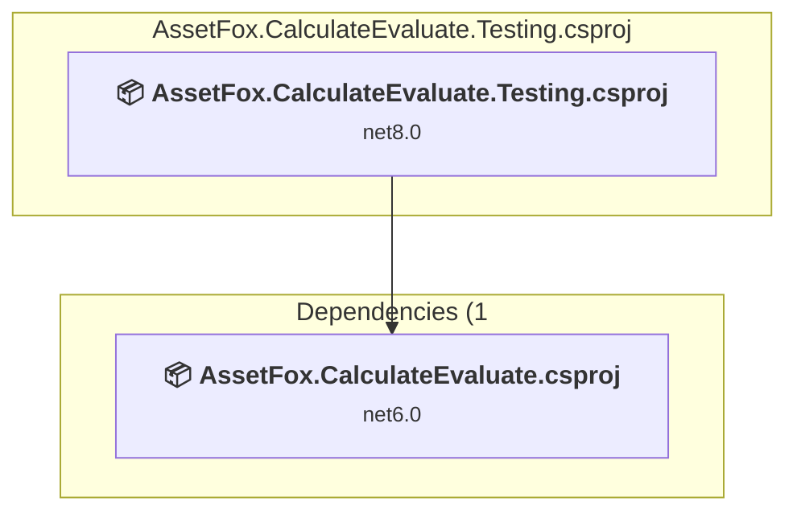

### API Compatibility

| Category | Count | Impact |
| :--- | :---: | :--- |
| 🔴 Binary Incompatible | 0 | High - Require code changes |
| 🟡 Source Incompatible | 0 | Medium - Needs re-compilation and potential conflicting API error fixing |
| 🔵 Behavioral change | 0 | Low - Behavioral changes that may require testing at runtime |
| ✅ Compatible | 0 |  |
| ***Total APIs Analyzed*** | ***0*** |  |

<a id="assetfoxcalculateevaluateassetfoxcalculateevaluatecsproj"></a>
### AssetFox.CalculateEvaluate\AssetFox.CalculateEvaluate.csproj

#### Project Info

- **Current Target Framework:** net6.0
- **Proposed Target Framework:** net8.0
- **SDK-style**: True
- **Project Kind:** ClassLibrary
- **Dependencies**: 3
- **Dependants**: 3
- **Number of Files**: 22
- **Number of Files with Incidents**: 2
- **Lines of Code**: 3528
- **Estimated LOC to modify**: 2+ (at least 0.1% of the project)

#### Dependency Graph

Legend:
📦 SDK-style project
⚙️ Classic project

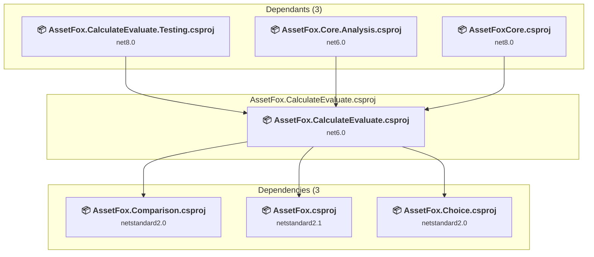

### API Compatibility

| Category | Count | Impact |
| :--- | :---: | :--- |
| 🔴 Binary Incompatible | 0 | High - Require code changes |
| 🟡 Source Incompatible | 2 | Medium - Needs re-compilation and potential conflicting API error fixing |
| 🔵 Behavioral change | 0 | Low - Behavioral changes that may require testing at runtime |
| ✅ Compatible | 2212 |  |
| ***Total APIs Analyzed*** | ***2214*** |  |

<a id="assetfoxchoiceassetfoxchoicecsproj"></a>
### AssetFox.Choice\AssetFox.Choice.csproj

#### Project Info

- **Current Target Framework:** netstandard2.0✅
- **SDK-style**: True
- **Project Kind:** ClassLibrary
- **Dependencies**: 0
- **Dependants**: 3
- **Number of Files**: 1
- **Lines of Code**: 2974
- **Estimated LOC to modify**: 0+ (at least 0.0% of the project)

#### Dependency Graph

Legend:
📦 SDK-style project
⚙️ Classic project

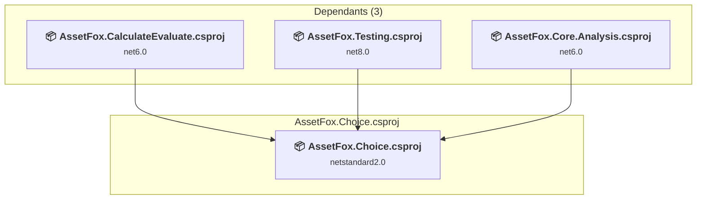

### API Compatibility

| Category | Count | Impact |
| :--- | :---: | :--- |
| 🔴 Binary Incompatible | 0 | High - Require code changes |
| 🟡 Source Incompatible | 0 | Medium - Needs re-compilation and potential conflicting API error fixing |
| 🔵 Behavioral change | 0 | Low - Behavioral changes that may require testing at runtime |
| ✅ Compatible | 700 |  |
| ***Total APIs Analyzed*** | ***700*** |  |

<a id="assetfoxcomparisonassetfoxcomparisoncsproj"></a>
### AssetFox.Comparison\AssetFox.Comparison.csproj

#### Project Info

- **Current Target Framework:** netstandard2.0✅
- **SDK-style**: True
- **Project Kind:** ClassLibrary
- **Dependencies**: 0
- **Dependants**: 2
- **Number of Files**: 6
- **Number of Files with Incidents**: 1
- **Lines of Code**: 434
- **Estimated LOC to modify**: 0+ (at least 0.0% of the project)

#### Dependency Graph

Legend:
📦 SDK-style project
⚙️ Classic project

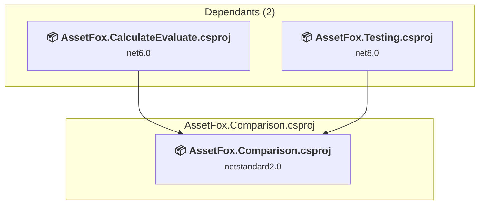

### API Compatibility

| Category | Count | Impact |
| :--- | :---: | :--- |
| 🔴 Binary Incompatible | 0 | High - Require code changes |
| 🟡 Source Incompatible | 0 | Medium - Needs re-compilation and potential conflicting API error fixing |
| 🔵 Behavioral change | 0 | Low - Behavioral changes that may require testing at runtime |
| ✅ Compatible | 325 |  |
| ***Total APIs Analyzed*** | ***325*** |  |

<a id="assetfoxcoreanalysisconsoleappassetfoxcoreanalysisconsoleappcsproj"></a>
### AssetFox.Core.Analysis.ConsoleApp\AssetFox.Core.Analysis.ConsoleApp.csproj

#### Project Info

- **Current Target Framework:** net8.0✅
- **SDK-style**: True
- **Project Kind:** DotNetCoreApp
- **Dependencies**: 1
- **Dependants**: 0
- **Number of Files**: 1
- **Lines of Code**: 64
- **Estimated LOC to modify**: 0+ (at least 0.0% of the project)

#### Dependency Graph

Legend:
📦 SDK-style project
⚙️ Classic project

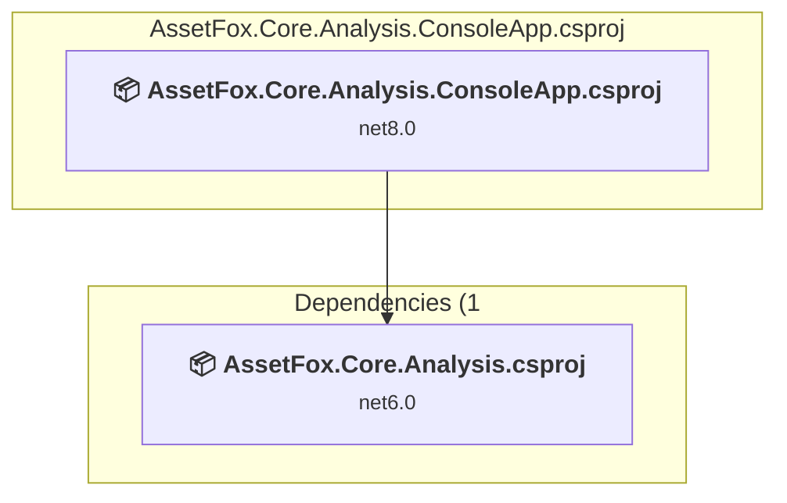

### API Compatibility

| Category | Count | Impact |
| :--- | :---: | :--- |
| 🔴 Binary Incompatible | 0 | High - Require code changes |
| 🟡 Source Incompatible | 0 | Medium - Needs re-compilation and potential conflicting API error fixing |
| 🔵 Behavioral change | 0 | Low - Behavioral changes that may require testing at runtime |
| ✅ Compatible | 0 |  |
| ***Total APIs Analyzed*** | ***0*** |  |

<a id="assetfoxcoreanalysislogictestingassetfoxcoreanalysislogictestingcsproj"></a>
### AssetFox.Core.Analysis.Logic.Testing\AssetFox.Core.Analysis.Logic.Testing.csproj

#### Project Info

- **Current Target Framework:** net8.0✅
- **SDK-style**: True
- **Project Kind:** DotNetCoreApp
- **Dependencies**: 1
- **Dependants**: 0
- **Number of Files**: 6
- **Lines of Code**: 802
- **Estimated LOC to modify**: 0+ (at least 0.0% of the project)

#### Dependency Graph

Legend:
📦 SDK-style project
⚙️ Classic project

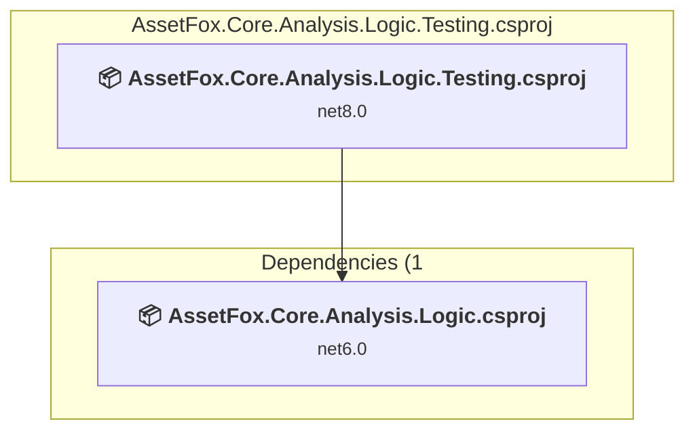

### API Compatibility

| Category | Count | Impact |
| :--- | :---: | :--- |
| 🔴 Binary Incompatible | 0 | High - Require code changes |
| 🟡 Source Incompatible | 0 | Medium - Needs re-compilation and potential conflicting API error fixing |
| 🔵 Behavioral change | 0 | Low - Behavioral changes that may require testing at runtime |
| ✅ Compatible | 0 |  |
| ***Total APIs Analyzed*** | ***0*** |  |

<a id="assetfoxcoreanalysislogicassetfoxcoreanalysislogiccsproj"></a>
### AssetFox.Core.Analysis.Logic\AssetFox.Core.Analysis.Logic.csproj

#### Project Info

- **Current Target Framework:** net6.0
- **Proposed Target Framework:** net8.0
- **SDK-style**: True
- **Project Kind:** ClassLibrary
- **Dependencies**: 0
- **Dependants**: 2
- **Number of Files**: 5
- **Number of Files with Incidents**: 1
- **Lines of Code**: 783
- **Estimated LOC to modify**: 0+ (at least 0.0% of the project)

#### Dependency Graph

Legend:
📦 SDK-style project
⚙️ Classic project

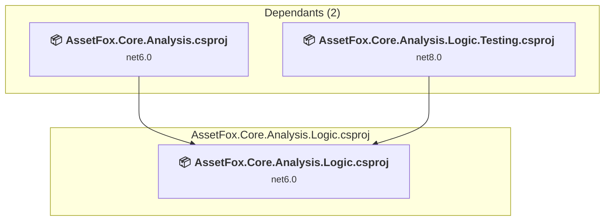

### API Compatibility

| Category | Count | Impact |
| :--- | :---: | :--- |
| 🔴 Binary Incompatible | 0 | High - Require code changes |
| 🟡 Source Incompatible | 0 | Medium - Needs re-compilation and potential conflicting API error fixing |
| 🔵 Behavioral change | 0 | Low - Behavioral changes that may require testing at runtime |
| ✅ Compatible | 386 |  |
| ***Total APIs Analyzed*** | ***386*** |  |

<a id="assetfoxcoreanalysistestingassetfoxcoreanalysistestingcsproj"></a>
### AssetFox.Core.Analysis.Testing\AssetFox.Core.Analysis.Testing.csproj

#### Project Info

- **Current Target Framework:** net8.0✅
- **SDK-style**: True
- **Project Kind:** DotNetCoreApp
- **Dependencies**: 1
- **Dependants**: 0
- **Number of Files**: 10
- **Lines of Code**: 479
- **Estimated LOC to modify**: 0+ (at least 0.0% of the project)

#### Dependency Graph

Legend:
📦 SDK-style project
⚙️ Classic project

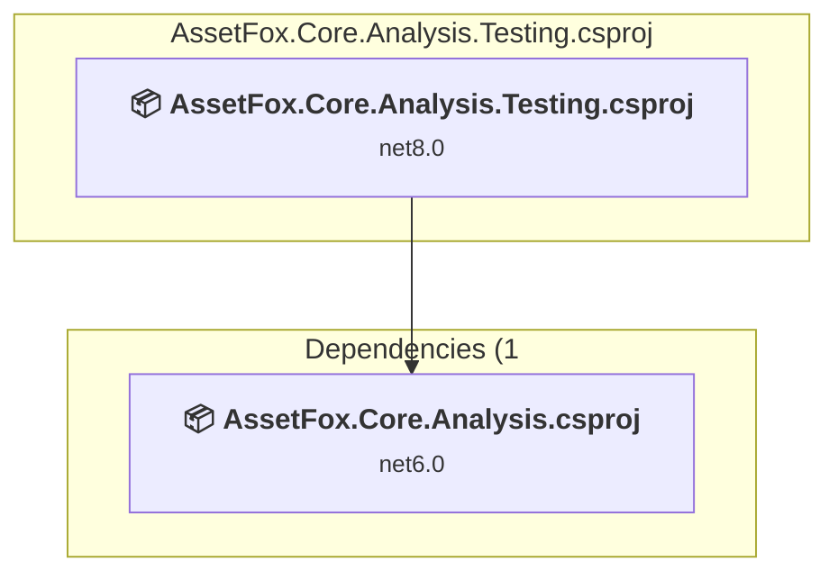

### API Compatibility

| Category | Count | Impact |
| :--- | :---: | :--- |
| 🔴 Binary Incompatible | 0 | High - Require code changes |
| 🟡 Source Incompatible | 0 | Medium - Needs re-compilation and potential conflicting API error fixing |
| 🔵 Behavioral change | 0 | Low - Behavioral changes that may require testing at runtime |
| ✅ Compatible | 0 |  |
| ***Total APIs Analyzed*** | ***0*** |  |

<a id="assetfoxcoreanalysisassetfoxcoreanalysiscsproj"></a>
### AssetFox.Core.Analysis\AssetFox.Core.Analysis.csproj

#### Project Info

- **Current Target Framework:** net6.0
- **Proposed Target Framework:** net8.0
- **SDK-style**: True
- **Project Kind:** ClassLibrary
- **Dependencies**: 9
- **Dependants**: 3
- **Number of Files**: 130
- **Number of Files with Incidents**: 3
- **Lines of Code**: 8573
- **Estimated LOC to modify**: 4+ (at least 0.0% of the project)

#### Dependency Graph

Legend:
📦 SDK-style project
⚙️ Classic project

```mermaid
flowchart TB
    subgraph upstream["Dependants (3)"]
        P14["<b>📦&nbsp;AssetFox.Core.DataPersistenceCore.csproj</b><br/><small>net8.0</small>"]
        P15["<b>📦&nbsp;AssetFox.Core.Analysis.Testing.csproj</b><br/><small>net8.0</small>"]
        P28["<b>📦&nbsp;AssetFox.Core.Analysis.ConsoleApp.csproj</b><br/><small>net8.0</small>"]
        click P14 "#assetfoxcoredatapersistencecoreassetfoxcoredatapersistencecorecsproj"
        click P15 "#assetfoxcoreanalysistestingassetfoxcoreanalysistestingcsproj"
        click P28 "#assetfoxcoreanalysisconsoleappassetfoxcoreanalysisconsoleappcsproj"
    end
    subgraph current["AssetFox.Core.Analysis.csproj"]
        MAIN["<b>📦&nbsp;AssetFox.Core.Analysis.csproj</b><br/><small>net6.0</small>"]
        click MAIN "#assetfoxcoreanalysisassetfoxcoreanalysiscsproj"
    end
    subgraph downstream["Dependencies (9"]
        P6["<b>📦&nbsp;AssetFox.Validation.csproj</b><br/><small>netstandard2.0</small>"]
        P29["<b>📦&nbsp;AssetFox.Core.Analysis.Logic.csproj</b><br/><small>net6.0</small>"]
        P18["<b>📦&nbsp;AssetFox.Core.DTOs.csproj</b><br/><small>netstandard2.1</small>"]
        P7["<b>📦&nbsp;AssetFox.Zip.csproj</b><br/><small>netstandard2.0</small>"]
        P10["<b>📦&nbsp;AssetFox.Option.csproj</b><br/><small>netstandard2.0</small>"]
        P12["<b>📦&nbsp;AssetFox.CycleDetection.csproj</b><br/><small>netstandard2.0</small>"]
        P8["<b>📦&nbsp;AssetFox.Choice.csproj</b><br/><small>netstandard2.0</small>"]
        P19["<b>📦&nbsp;AssetFox.Core.Data.csproj</b><br/><small>netstandard2.1</small>"]
        P2["<b>📦&nbsp;AssetFox.CalculateEvaluate.csproj</b><br/><small>net6.0</small>"]
        click P6 "#assetfoxvalidationassetfoxvalidationcsproj"
        click P29 "#assetfoxcoreanalysislogicassetfoxcoreanalysislogiccsproj"
        click P18 "#assetfoxcoredtosassetfoxcoredtoscsproj"
        click P7 "#assetfoxzipassetfoxzipcsproj"
        click P10 "#assetfoxoptionassetfoxoptioncsproj"
        click P12 "#assetfoxcycledetectionassetfoxcycledetectioncsproj"
        click P8 "#assetfoxchoiceassetfoxchoicecsproj"
        click P19 "#assetfoxcoredataassetfoxcoredatacsproj"
        click P2 "#assetfoxcalculateevaluateassetfoxcalculateevaluatecsproj"
    end
    P14 --> MAIN
    P15 --> MAIN
    P28 --> MAIN
    MAIN --> P6
    MAIN --> P29
    MAIN --> P18
    MAIN --> P7
    MAIN --> P10
    MAIN --> P12
    MAIN --> P8
    MAIN --> P19
    MAIN --> P2

```

### API Compatibility

| Category | Count | Impact |
| :--- | :---: | :--- |
| 🔴 Binary Incompatible | 0 | High - Require code changes |
| 🟡 Source Incompatible | 4 | Medium - Needs re-compilation and potential conflicting API error fixing |
| 🔵 Behavioral change | 0 | Low - Behavioral changes that may require testing at runtime |
| ✅ Compatible | 7189 |  |
| ***Total APIs Analyzed*** | ***7193*** |  |

<a id="assetfoxcorecommonassetfoxcorecommoncsproj"></a>
### AssetFox.Core.Common\AssetFox.Core.Common.csproj

#### Project Info

- **Current Target Framework:** net6.0
- **Proposed Target Framework:** net8.0
- **SDK-style**: True
- **Project Kind:** ClassLibrary
- **Dependencies**: 0
- **Dependants**: 2
- **Number of Files**: 19
- **Number of Files with Incidents**: 1
- **Lines of Code**: 430
- **Estimated LOC to modify**: 0+ (at least 0.0% of the project)

#### Dependency Graph

Legend:
📦 SDK-style project
⚙️ Classic project

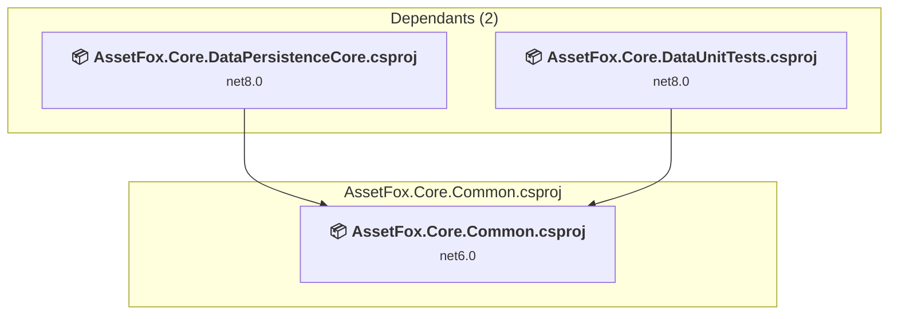

### API Compatibility

| Category | Count | Impact |
| :--- | :---: | :--- |
| 🔴 Binary Incompatible | 0 | High - Require code changes |
| 🟡 Source Incompatible | 0 | Medium - Needs re-compilation and potential conflicting API error fixing |
| 🔵 Behavioral change | 0 | Low - Behavioral changes that may require testing at runtime |
| ✅ Compatible | 355 |  |
| ***Total APIs Analyzed*** | ***355*** |  |

<a id="assetfoxcoredataassetfoxcoredatacsproj"></a>
### AssetFox.Core.Data\AssetFox.Core.Data.csproj

#### Project Info

- **Current Target Framework:** netstandard2.1✅
- **SDK-style**: True
- **Project Kind:** ClassLibrary
- **Dependencies**: 1
- **Dependants**: 4
- **Number of Files**: 62
- **Number of Files with Incidents**: 2
- **Lines of Code**: 1849
- **Estimated LOC to modify**: 16+ (at least 0.9% of the project)

#### Dependency Graph

Legend:
📦 SDK-style project
⚙️ Classic project

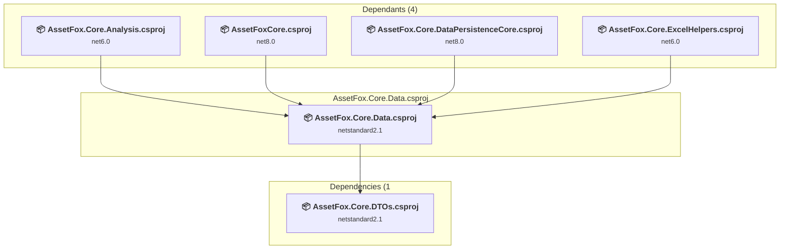

### API Compatibility

| Category | Count | Impact |
| :--- | :---: | :--- |
| 🔴 Binary Incompatible | 0 | High - Require code changes |
| 🟡 Source Incompatible | 16 | Medium - Needs re-compilation and potential conflicting API error fixing |
| 🔵 Behavioral change | 0 | Low - Behavioral changes that may require testing at runtime |
| ✅ Compatible | 1235 |  |
| ***Total APIs Analyzed*** | ***1251*** |  |

<a id="assetfoxcoredatapersistencecoreassetfoxcoredatapersistencecorecsproj"></a>
### AssetFox.Core.DataPersistenceCore\AssetFox.Core.DataPersistenceCore.csproj

#### Project Info

- **Current Target Framework:** net8.0✅
- **SDK-style**: True
- **Project Kind:** ClassLibrary
- **Dependencies**: 5
- **Dependants**: 3
- **Number of Files**: 581
- **Lines of Code**: 805770
- **Estimated LOC to modify**: 0+ (at least 0.0% of the project)

#### Dependency Graph

Legend:
📦 SDK-style project
⚙️ Classic project

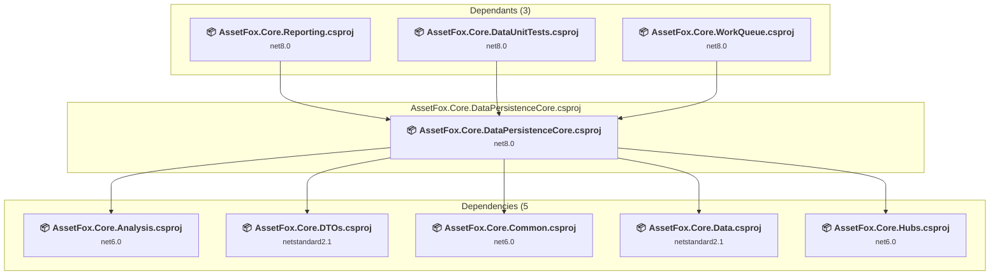

### API Compatibility

| Category | Count | Impact |
| :--- | :---: | :--- |
| 🔴 Binary Incompatible | 0 | High - Require code changes |
| 🟡 Source Incompatible | 0 | Medium - Needs re-compilation and potential conflicting API error fixing |
| 🔵 Behavioral change | 0 | Low - Behavioral changes that may require testing at runtime |
| ✅ Compatible | 0 |  |
| ***Total APIs Analyzed*** | ***0*** |  |

<a id="assetfoxcoredataunittestsassetfoxcoredataunittestscsproj"></a>
### AssetFox.Core.DataUnitTests\AssetFox.Core.DataUnitTests.csproj

#### Project Info

- **Current Target Framework:** net8.0✅
- **SDK-style**: True
- **Project Kind:** DotNetCoreApp
- **Dependencies**: 3
- **Dependants**: 2
- **Number of Files**: 37
- **Lines of Code**: 1811
- **Estimated LOC to modify**: 0+ (at least 0.0% of the project)

#### Dependency Graph

Legend:
📦 SDK-style project
⚙️ Classic project

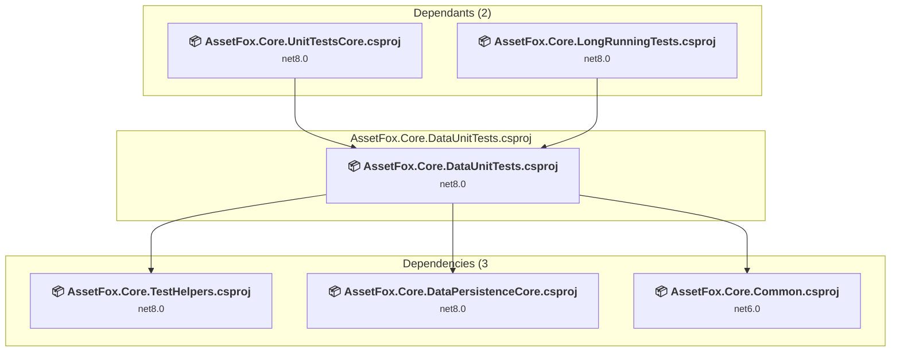

### API Compatibility

| Category | Count | Impact |
| :--- | :---: | :--- |
| 🔴 Binary Incompatible | 0 | High - Require code changes |
| 🟡 Source Incompatible | 0 | Medium - Needs re-compilation and potential conflicting API error fixing |
| 🔵 Behavioral change | 0 | Low - Behavioral changes that may require testing at runtime |
| ✅ Compatible | 0 |  |
| ***Total APIs Analyzed*** | ***0*** |  |

<a id="assetfoxcoredtosassetfoxcoredtoscsproj"></a>
### AssetFox.Core.DTOs\AssetFox.Core.DTOs.csproj

#### Project Info

- **Current Target Framework:** netstandard2.1✅
- **SDK-style**: True
- **Project Kind:** ClassLibrary
- **Dependencies**: 0
- **Dependants**: 4
- **Number of Files**: 133
- **Number of Files with Incidents**: 1
- **Lines of Code**: 2886
- **Estimated LOC to modify**: 0+ (at least 0.0% of the project)

#### Dependency Graph

Legend:
📦 SDK-style project
⚙️ Classic project

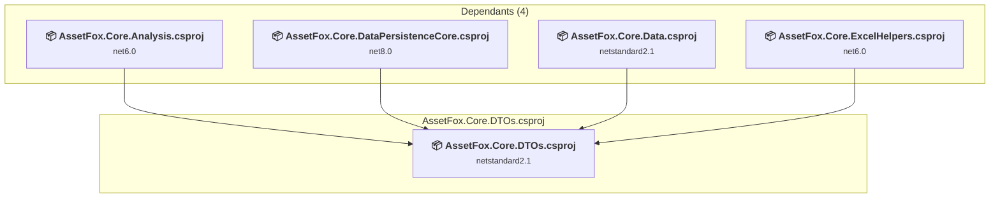

### API Compatibility

| Category | Count | Impact |
| :--- | :---: | :--- |
| 🔴 Binary Incompatible | 0 | High - Require code changes |
| 🟡 Source Incompatible | 0 | Medium - Needs re-compilation and potential conflicting API error fixing |
| 🔵 Behavioral change | 0 | Low - Behavioral changes that may require testing at runtime |
| ✅ Compatible | 1650 |  |
| ***Total APIs Analyzed*** | ***1650*** |  |

<a id="assetfoxcoreexcelhelpersassetfoxcoreexcelhelperscsproj"></a>
### AssetFox.Core.ExcelHelpers\AssetFox.Core.ExcelHelpers.csproj

#### Project Info

- **Current Target Framework:** net6.0
- **Proposed Target Framework:** net8.0
- **SDK-style**: True
- **Project Kind:** ClassLibrary
- **Dependencies**: 2
- **Dependants**: 1
- **Number of Files**: 54
- **Number of Files with Incidents**: 4
- **Lines of Code**: 1818
- **Estimated LOC to modify**: 9+ (at least 0.5% of the project)

#### Dependency Graph

Legend:
📦 SDK-style project
⚙️ Classic project

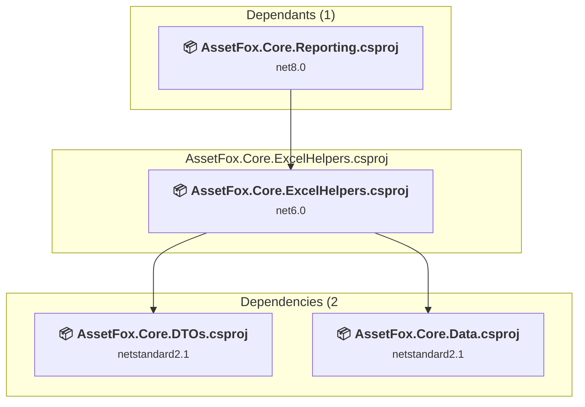

### API Compatibility

| Category | Count | Impact |
| :--- | :---: | :--- |
| 🔴 Binary Incompatible | 0 | High - Require code changes |
| 🟡 Source Incompatible | 9 | Medium - Needs re-compilation and potential conflicting API error fixing |
| 🔵 Behavioral change | 0 | Low - Behavioral changes that may require testing at runtime |
| ✅ Compatible | 1294 |  |
| ***Total APIs Analyzed*** | ***1303*** |  |

#### Project Technologies and Features

| Technology | Issues | Percentage | Migration Path |
| :--- | :---: | :---: | :--- |
| GDI+ / System.Drawing | 9 | 100.0% | System.Drawing APIs for 2D graphics, imaging, and printing that are available via NuGet package System.Drawing.Common. Note: Not recommended for server scenarios due to Windows dependencies; consider cross-platform alternatives like SkiaSharp or ImageSharp for new code. |

<a id="assetfoxcorehubsassetfoxcorehubscsproj"></a>
### AssetFox.Core.Hubs\AssetFox.Core.Hubs.csproj

#### Project Info

- **Current Target Framework:** net6.0
- **Proposed Target Framework:** net8.0
- **SDK-style**: True
- **Project Kind:** ClassLibrary
- **Dependencies**: 0
- **Dependants**: 4
- **Number of Files**: 3
- **Number of Files with Incidents**: 1
- **Lines of Code**: 150
- **Estimated LOC to modify**: 0+ (at least 0.0% of the project)

#### Dependency Graph

Legend:
📦 SDK-style project
⚙️ Classic project

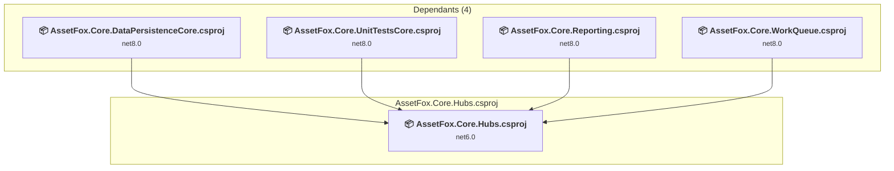

### API Compatibility

| Category | Count | Impact |
| :--- | :---: | :--- |
| 🔴 Binary Incompatible | 0 | High - Require code changes |
| 🟡 Source Incompatible | 0 | Medium - Needs re-compilation and potential conflicting API error fixing |
| 🔵 Behavioral change | 0 | Low - Behavioral changes that may require testing at runtime |
| ✅ Compatible | 242 |  |
| ***Total APIs Analyzed*** | ***242*** |  |

<a id="assetfoxcorelongrunningtestsassetfoxcorelongrunningtestscsproj"></a>
### AssetFox.Core.LongRunningTests\AssetFox.Core.LongRunningTests.csproj

#### Project Info

- **Current Target Framework:** net8.0✅
- **SDK-style**: True
- **Project Kind:** DotNetCoreApp
- **Dependencies**: 3
- **Dependants**: 0
- **Number of Files**: 5
- **Lines of Code**: 94
- **Estimated LOC to modify**: 0+ (at least 0.0% of the project)

#### Dependency Graph

Legend:
📦 SDK-style project
⚙️ Classic project

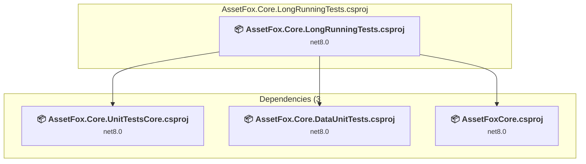

### API Compatibility

| Category | Count | Impact |
| :--- | :---: | :--- |
| 🔴 Binary Incompatible | 0 | High - Require code changes |
| 🟡 Source Incompatible | 0 | Medium - Needs re-compilation and potential conflicting API error fixing |
| 🔵 Behavioral change | 0 | Low - Behavioral changes that may require testing at runtime |
| ✅ Compatible | 0 |  |
| ***Total APIs Analyzed*** | ***0*** |  |

<a id="assetfoxcorereportingassetfoxcorereportingcsproj"></a>
### AssetFox.Core.Reporting\AssetFox.Core.Reporting.csproj

#### Project Info

- **Current Target Framework:** net8.0✅
- **SDK-style**: True
- **Project Kind:** ClassLibrary
- **Dependencies**: 4
- **Dependants**: 2
- **Number of Files**: 206
- **Lines of Code**: 31082
- **Estimated LOC to modify**: 0+ (at least 0.0% of the project)

#### Dependency Graph

Legend:
📦 SDK-style project
⚙️ Classic project

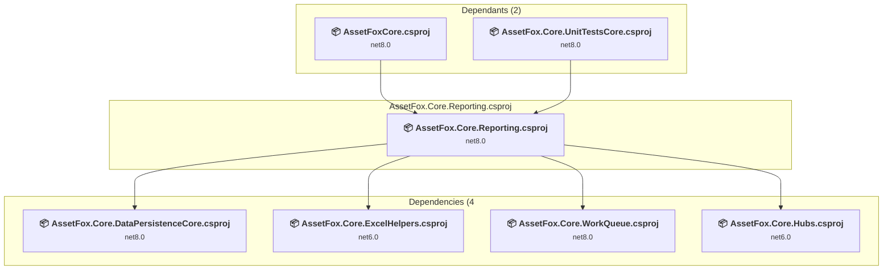

### API Compatibility

| Category | Count | Impact |
| :--- | :---: | :--- |
| 🔴 Binary Incompatible | 0 | High - Require code changes |
| 🟡 Source Incompatible | 0 | Medium - Needs re-compilation and potential conflicting API error fixing |
| 🔵 Behavioral change | 0 | Low - Behavioral changes that may require testing at runtime |
| ✅ Compatible | 0 |  |
| ***Total APIs Analyzed*** | ***0*** |  |

<a id="assetfoxcoretesthelpersassetfoxcoretesthelperscsproj"></a>
### AssetFox.Core.TestHelpers\AssetFox.Core.TestHelpers.csproj

#### Project Info

- **Current Target Framework:** net8.0✅
- **SDK-style**: True
- **Project Kind:** DotNetCoreApp
- **Dependencies**: 0
- **Dependants**: 1
- **Number of Files**: 13
- **Lines of Code**: 311
- **Estimated LOC to modify**: 0+ (at least 0.0% of the project)

#### Dependency Graph

Legend:
📦 SDK-style project
⚙️ Classic project

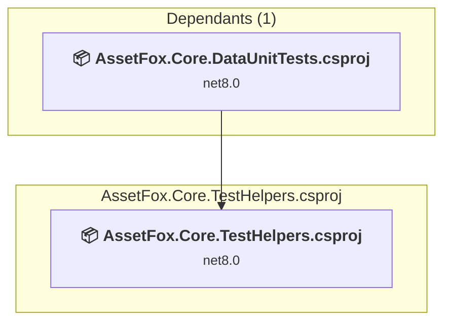

### API Compatibility

| Category | Count | Impact |
| :--- | :---: | :--- |
| 🔴 Binary Incompatible | 0 | High - Require code changes |
| 🟡 Source Incompatible | 0 | Medium - Needs re-compilation and potential conflicting API error fixing |
| 🔵 Behavioral change | 0 | Low - Behavioral changes that may require testing at runtime |
| ✅ Compatible | 0 |  |
| ***Total APIs Analyzed*** | ***0*** |  |

<a id="assetfoxcoreunittestscoreassetfoxcoreunittestscorecsproj"></a>
### AssetFox.Core.UnitTestsCore\AssetFox.Core.UnitTestsCore.csproj

#### Project Info

- **Current Target Framework:** net8.0✅
- **SDK-style**: True
- **Project Kind:** DotNetCoreApp
- **Dependencies**: 3
- **Dependants**: 2
- **Number of Files**: 231
- **Lines of Code**: 21317
- **Estimated LOC to modify**: 0+ (at least 0.0% of the project)

#### Dependency Graph

Legend:
📦 SDK-style project
⚙️ Classic project

```mermaid
flowchart TB
    subgraph upstream["Dependants (2)"]
        P25["<b>📦&nbsp;AssetFox.Core.LongRunningTests.csproj</b><br/><small>net8.0</small>"]
        P26["<b>📦&nbsp;BridgeCareCoreTests.csproj</b><br/><small>net8.0</small>"]
        click P25 "#assetfoxcorelongrunningtestsassetfoxcorelongrunningtestscsproj"
        click P26 "#bridgecarecoretestsbridgecarecoretestscsproj"
    end
    subgraph current["AssetFox.Core.UnitTestsCore.csproj"]
        MAIN["<b>📦&nbsp;AssetFox.Core.UnitTestsCore.csproj</b><br/><small>net8.0</small>"]
        click MAIN "#assetfoxcoreunittestscoreassetfoxcoreunittestscorecsproj"
    end
    subgraph downstream["Dependencies (3"]
        P22["<b>📦&nbsp;AssetFox.Core.DataUnitTests.csproj</b><br/><small>net8.0</small>"]
        P17["<b>📦&nbsp;AssetFox.Core.Reporting.csproj</b><br/><small>net8.0</small>"]
        P24["<b>📦&nbsp;AssetFox.Core.Hubs.csproj</b><br/><small>net6.0</small>"]
        click P22 "#assetfoxcoredataunittestsassetfoxcoredataunittestscsproj"
        click P17 "#assetfoxcorereportingassetfoxcorereportingcsproj"
        click P24 "#assetfoxcorehubsassetfoxcorehubscsproj"
    end
    P25 --> MAIN
    P26 --> MAIN
    MAIN --> P22
    MAIN --> P17
    MAIN --> P24

```

### API Compatibility

| Category | Count | Impact |
| :--- | :---: | :--- |
| 🔴 Binary Incompatible | 0 | High - Require code changes |
| 🟡 Source Incompatible | 0 | Medium - Needs re-compilation and potential conflicting API error fixing |
| 🔵 Behavioral change | 0 | Low - Behavioral changes that may require testing at runtime |
| ✅ Compatible | 0 |  |
| ***Total APIs Analyzed*** | ***0*** |  |

<a id="assetfoxcoreworkqueueassetfoxcoreworkqueuecsproj"></a>
### AssetFox.Core.WorkQueue\AssetFox.Core.WorkQueue.csproj

#### Project Info

- **Current Target Framework:** net8.0✅
- **SDK-style**: True
- **Project Kind:** ClassLibrary
- **Dependencies**: 2
- **Dependants**: 2
- **Number of Files**: 8
- **Lines of Code**: 310
- **Estimated LOC to modify**: 0+ (at least 0.0% of the project)

#### Dependency Graph

Legend:
📦 SDK-style project
⚙️ Classic project

```mermaid
flowchart TB
    subgraph upstream["Dependants (2)"]
        P13["<b>📦&nbsp;AssetFoxCore.csproj</b><br/><small>net8.0</small>"]
        P17["<b>📦&nbsp;AssetFox.Core.Reporting.csproj</b><br/><small>net8.0</small>"]
        click P13 "#assetfoxcoreassetfoxcorecsproj"
        click P17 "#assetfoxcorereportingassetfoxcorereportingcsproj"
    end
    subgraph current["AssetFox.Core.WorkQueue.csproj"]
        MAIN["<b>📦&nbsp;AssetFox.Core.WorkQueue.csproj</b><br/><small>net8.0</small>"]
        click MAIN "#assetfoxcoreworkqueueassetfoxcoreworkqueuecsproj"
    end
    subgraph downstream["Dependencies (2"]
        P14["<b>📦&nbsp;AssetFox.Core.DataPersistenceCore.csproj</b><br/><small>net8.0</small>"]
        P24["<b>📦&nbsp;AssetFox.Core.Hubs.csproj</b><br/><small>net6.0</small>"]
        click P14 "#assetfoxcoredatapersistencecoreassetfoxcoredatapersistencecorecsproj"
        click P24 "#assetfoxcorehubsassetfoxcorehubscsproj"
    end
    P13 --> MAIN
    P17 --> MAIN
    MAIN --> P14
    MAIN --> P24

```

### API Compatibility

| Category | Count | Impact |
| :--- | :---: | :--- |
| 🔴 Binary Incompatible | 0 | High - Require code changes |
| 🟡 Source Incompatible | 0 | Medium - Needs re-compilation and potential conflicting API error fixing |
| 🔵 Behavioral change | 0 | Low - Behavioral changes that may require testing at runtime |
| ✅ Compatible | 0 |  |
| ***Total APIs Analyzed*** | ***0*** |  |

<a id="assetfoxcycledetectionassetfoxcycledetectioncsproj"></a>
### AssetFox.CycleDetection\AssetFox.CycleDetection.csproj

#### Project Info

- **Current Target Framework:** netstandard2.0✅
- **SDK-style**: True
- **Project Kind:** ClassLibrary
- **Dependencies**: 0
- **Dependants**: 2
- **Number of Files**: 1
- **Lines of Code**: 103
- **Estimated LOC to modify**: 0+ (at least 0.0% of the project)

#### Dependency Graph

Legend:
📦 SDK-style project
⚙️ Classic project

```mermaid
flowchart TB
    subgraph upstream["Dependants (2)"]
        P4["<b>📦&nbsp;AssetFox.Testing.csproj</b><br/><small>net8.0</small>"]
        P5["<b>📦&nbsp;AssetFox.Core.Analysis.csproj</b><br/><small>net6.0</small>"]
        click P4 "#assetfoxtestingassetfoxtestingcsproj"
        click P5 "#assetfoxcoreanalysisassetfoxcoreanalysiscsproj"
    end
    subgraph current["AssetFox.CycleDetection.csproj"]
        MAIN["<b>📦&nbsp;AssetFox.CycleDetection.csproj</b><br/><small>netstandard2.0</small>"]
        click MAIN "#assetfoxcycledetectionassetfoxcycledetectioncsproj"
    end
    P4 --> MAIN
    P5 --> MAIN

```

### API Compatibility

| Category | Count | Impact |
| :--- | :---: | :--- |
| 🔴 Binary Incompatible | 0 | High - Require code changes |
| 🟡 Source Incompatible | 0 | Medium - Needs re-compilation and potential conflicting API error fixing |
| 🔵 Behavioral change | 0 | Low - Behavioral changes that may require testing at runtime |
| ✅ Compatible | 54 |  |
| ***Total APIs Analyzed*** | ***54*** |  |

<a id="assetfoxoptionassetfoxoptioncsproj"></a>
### AssetFox.Option\AssetFox.Option.csproj

#### Project Info

- **Current Target Framework:** netstandard2.0✅
- **SDK-style**: True
- **Project Kind:** ClassLibrary
- **Dependencies**: 0
- **Dependants**: 1
- **Number of Files**: 3
- **Number of Files with Incidents**: 1
- **Lines of Code**: 350
- **Estimated LOC to modify**: 0+ (at least 0.0% of the project)

#### Dependency Graph

Legend:
📦 SDK-style project
⚙️ Classic project

```mermaid
flowchart TB
    subgraph upstream["Dependants (1)"]
        P5["<b>📦&nbsp;AssetFox.Core.Analysis.csproj</b><br/><small>net6.0</small>"]
        click P5 "#assetfoxcoreanalysisassetfoxcoreanalysiscsproj"
    end
    subgraph current["AssetFox.Option.csproj"]
        MAIN["<b>📦&nbsp;AssetFox.Option.csproj</b><br/><small>netstandard2.0</small>"]
        click MAIN "#assetfoxoptionassetfoxoptioncsproj"
    end
    P5 --> MAIN

```

### API Compatibility

| Category | Count | Impact |
| :--- | :---: | :--- |
| 🔴 Binary Incompatible | 0 | High - Require code changes |
| 🟡 Source Incompatible | 0 | Medium - Needs re-compilation and potential conflicting API error fixing |
| 🔵 Behavioral change | 0 | Low - Behavioral changes that may require testing at runtime |
| ✅ Compatible | 123 |  |
| ***Total APIs Analyzed*** | ***123*** |  |

<a id="assetfoxtestingassetfoxtestingcsproj"></a>
### AssetFox.Testing\AssetFox.Testing.csproj

#### Project Info

- **Current Target Framework:** net8.0✅
- **SDK-style**: True
- **Project Kind:** DotNetCoreApp
- **Dependencies**: 3
- **Dependants**: 0
- **Number of Files**: 5
- **Lines of Code**: 91
- **Estimated LOC to modify**: 0+ (at least 0.0% of the project)

#### Dependency Graph

Legend:
📦 SDK-style project
⚙️ Classic project

```mermaid
flowchart TB
    subgraph current["AssetFox.Testing.csproj"]
        MAIN["<b>📦&nbsp;AssetFox.Testing.csproj</b><br/><small>net8.0</small>"]
        click MAIN "#assetfoxtestingassetfoxtestingcsproj"
    end
    subgraph downstream["Dependencies (3"]
        P9["<b>📦&nbsp;AssetFox.Comparison.csproj</b><br/><small>netstandard2.0</small>"]
        P12["<b>📦&nbsp;AssetFox.CycleDetection.csproj</b><br/><small>netstandard2.0</small>"]
        P8["<b>📦&nbsp;AssetFox.Choice.csproj</b><br/><small>netstandard2.0</small>"]
        click P9 "#assetfoxcomparisonassetfoxcomparisoncsproj"
        click P12 "#assetfoxcycledetectionassetfoxcycledetectioncsproj"
        click P8 "#assetfoxchoiceassetfoxchoicecsproj"
    end
    MAIN --> P9
    MAIN --> P12
    MAIN --> P8

```

### API Compatibility

| Category | Count | Impact |
| :--- | :---: | :--- |
| 🔴 Binary Incompatible | 0 | High - Require code changes |
| 🟡 Source Incompatible | 0 | Medium - Needs re-compilation and potential conflicting API error fixing |
| 🔵 Behavioral change | 0 | Low - Behavioral changes that may require testing at runtime |
| ✅ Compatible | 0 |  |
| ***Total APIs Analyzed*** | ***0*** |  |

<a id="assetfoxvalidationassetfoxvalidationcsproj"></a>
### AssetFox.Validation\AssetFox.Validation.csproj

#### Project Info

- **Current Target Framework:** netstandard2.0✅
- **SDK-style**: True
- **Project Kind:** ClassLibrary
- **Dependencies**: 0
- **Dependants**: 1
- **Number of Files**: 9
- **Number of Files with Incidents**: 1
- **Lines of Code**: 227
- **Estimated LOC to modify**: 0+ (at least 0.0% of the project)

#### Dependency Graph

Legend:
📦 SDK-style project
⚙️ Classic project

```mermaid
flowchart TB
    subgraph upstream["Dependants (1)"]
        P5["<b>📦&nbsp;AssetFox.Core.Analysis.csproj</b><br/><small>net6.0</small>"]
        click P5 "#assetfoxcoreanalysisassetfoxcoreanalysiscsproj"
    end
    subgraph current["AssetFox.Validation.csproj"]
        MAIN["<b>📦&nbsp;AssetFox.Validation.csproj</b><br/><small>netstandard2.0</small>"]
        click MAIN "#assetfoxvalidationassetfoxvalidationcsproj"
    end
    P5 --> MAIN

```

### API Compatibility

| Category | Count | Impact |
| :--- | :---: | :--- |
| 🔴 Binary Incompatible | 0 | High - Require code changes |
| 🟡 Source Incompatible | 0 | Medium - Needs re-compilation and potential conflicting API error fixing |
| 🔵 Behavioral change | 0 | Low - Behavioral changes that may require testing at runtime |
| ✅ Compatible | 192 |  |
| ***Total APIs Analyzed*** | ***192*** |  |

<a id="assetfoxzipassetfoxzipcsproj"></a>
### AssetFox.Zip\AssetFox.Zip.csproj

#### Project Info

- **Current Target Framework:** netstandard2.0✅
- **SDK-style**: True
- **Project Kind:** ClassLibrary
- **Dependencies**: 0
- **Dependants**: 1
- **Number of Files**: 2
- **Lines of Code**: 470
- **Estimated LOC to modify**: 0+ (at least 0.0% of the project)

#### Dependency Graph

Legend:
📦 SDK-style project
⚙️ Classic project

```mermaid
flowchart TB
    subgraph upstream["Dependants (1)"]
        P5["<b>📦&nbsp;AssetFox.Core.Analysis.csproj</b><br/><small>net6.0</small>"]
        click P5 "#assetfoxcoreanalysisassetfoxcoreanalysiscsproj"
    end
    subgraph current["AssetFox.Zip.csproj"]
        MAIN["<b>📦&nbsp;AssetFox.Zip.csproj</b><br/><small>netstandard2.0</small>"]
        click MAIN "#assetfoxzipassetfoxzipcsproj"
    end
    P5 --> MAIN

```

### API Compatibility

| Category | Count | Impact |
| :--- | :---: | :--- |
| 🔴 Binary Incompatible | 0 | High - Require code changes |
| 🟡 Source Incompatible | 0 | Medium - Needs re-compilation and potential conflicting API error fixing |
| 🔵 Behavioral change | 0 | Low - Behavioral changes that may require testing at runtime |
| ✅ Compatible | 713 |  |
| ***Total APIs Analyzed*** | ***713*** |  |

<a id="assetfoxassetfoxcsproj"></a>
### AssetFox\AssetFox.csproj

#### Project Info

- **Current Target Framework:** netstandard2.1✅
- **SDK-style**: True
- **Project Kind:** ClassLibrary
- **Dependencies**: 0
- **Dependants**: 1
- **Number of Files**: 1
- **Lines of Code**: 26
- **Estimated LOC to modify**: 0+ (at least 0.0% of the project)

#### Dependency Graph

Legend:
📦 SDK-style project
⚙️ Classic project

```mermaid
flowchart TB
    subgraph upstream["Dependants (1)"]
        P2["<b>📦&nbsp;AssetFox.CalculateEvaluate.csproj</b><br/><small>net6.0</small>"]
        click P2 "#assetfoxcalculateevaluateassetfoxcalculateevaluatecsproj"
    end
    subgraph current["AssetFox.csproj"]
        MAIN["<b>📦&nbsp;AssetFox.csproj</b><br/><small>netstandard2.1</small>"]
        click MAIN "#assetfoxassetfoxcsproj"
    end
    P2 --> MAIN

```

### API Compatibility

| Category | Count | Impact |
| :--- | :---: | :--- |
| 🔴 Binary Incompatible | 0 | High - Require code changes |
| 🟡 Source Incompatible | 0 | Medium - Needs re-compilation and potential conflicting API error fixing |
| 🔵 Behavioral change | 0 | Low - Behavioral changes that may require testing at runtime |
| ✅ Compatible | 12 |  |
| ***Total APIs Analyzed*** | ***12*** |  |

<a id="assetfoxcoreassetfoxcorecsproj"></a>
### AssetFoxCore\AssetFoxCore.csproj

#### Project Info

- **Current Target Framework:** net8.0✅
- **SDK-style**: True
- **Project Kind:** AspNetCore
- **Dependencies**: 4
- **Dependants**: 2
- **Number of Files**: 268
- **Lines of Code**: 24800
- **Estimated LOC to modify**: 0+ (at least 0.0% of the project)

#### Dependency Graph

Legend:
📦 SDK-style project
⚙️ Classic project

```mermaid
flowchart TB
    subgraph upstream["Dependants (2)"]
        P25["<b>📦&nbsp;AssetFox.Core.LongRunningTests.csproj</b><br/><small>net8.0</small>"]
        P26["<b>📦&nbsp;BridgeCareCoreTests.csproj</b><br/><small>net8.0</small>"]
        click P25 "#assetfoxcorelongrunningtestsassetfoxcorelongrunningtestscsproj"
        click P26 "#bridgecarecoretestsbridgecarecoretestscsproj"
    end
    subgraph current["AssetFoxCore.csproj"]
        MAIN["<b>📦&nbsp;AssetFoxCore.csproj</b><br/><small>net8.0</small>"]
        click MAIN "#assetfoxcoreassetfoxcorecsproj"
    end
    subgraph downstream["Dependencies (4"]
        P27["<b>📦&nbsp;AssetFox.Core.WorkQueue.csproj</b><br/><small>net8.0</small>"]
        P17["<b>📦&nbsp;AssetFox.Core.Reporting.csproj</b><br/><small>net8.0</small>"]
        P19["<b>📦&nbsp;AssetFox.Core.Data.csproj</b><br/><small>netstandard2.1</small>"]
        P2["<b>📦&nbsp;AssetFox.CalculateEvaluate.csproj</b><br/><small>net6.0</small>"]
        click P27 "#assetfoxcoreworkqueueassetfoxcoreworkqueuecsproj"
        click P17 "#assetfoxcorereportingassetfoxcorereportingcsproj"
        click P19 "#assetfoxcoredataassetfoxcoredatacsproj"
        click P2 "#assetfoxcalculateevaluateassetfoxcalculateevaluatecsproj"
    end
    P25 --> MAIN
    P26 --> MAIN
    MAIN --> P27
    MAIN --> P17
    MAIN --> P19
    MAIN --> P2

```

### API Compatibility

| Category | Count | Impact |
| :--- | :---: | :--- |
| 🔴 Binary Incompatible | 0 | High - Require code changes |
| 🟡 Source Incompatible | 0 | Medium - Needs re-compilation and potential conflicting API error fixing |
| 🔵 Behavioral change | 0 | Low - Behavioral changes that may require testing at runtime |
| ✅ Compatible | 0 |  |
| ***Total APIs Analyzed*** | ***0*** |  |

<a id="bridgecarecoretestsbridgecarecoretestscsproj"></a>
### BridgeCareCoreTests\BridgeCareCoreTests.csproj

#### Project Info

- **Current Target Framework:** net8.0✅
- **SDK-style**: True
- **Project Kind:** DotNetCoreApp
- **Dependencies**: 2
- **Dependants**: 0
- **Number of Files**: 155
- **Lines of Code**: 20528
- **Estimated LOC to modify**: 0+ (at least 0.0% of the project)

#### Dependency Graph

Legend:
📦 SDK-style project
⚙️ Classic project

```mermaid
flowchart TB
    subgraph current["BridgeCareCoreTests.csproj"]
        MAIN["<b>📦&nbsp;BridgeCareCoreTests.csproj</b><br/><small>net8.0</small>"]
        click MAIN "#bridgecarecoretestsbridgecarecoretestscsproj"
    end
    subgraph downstream["Dependencies (2"]
        P16["<b>📦&nbsp;AssetFox.Core.UnitTestsCore.csproj</b><br/><small>net8.0</small>"]
        P13["<b>📦&nbsp;AssetFoxCore.csproj</b><br/><small>net8.0</small>"]
        click P16 "#assetfoxcoreunittestscoreassetfoxcoreunittestscorecsproj"
        click P13 "#assetfoxcoreassetfoxcorecsproj"
    end
    MAIN --> P16
    MAIN --> P13

```

### API Compatibility

| Category | Count | Impact |
| :--- | :---: | :--- |
| 🔴 Binary Incompatible | 0 | High - Require code changes |
| 🟡 Source Incompatible | 0 | Medium - Needs re-compilation and potential conflicting API error fixing |
| 🔵 Behavioral change | 0 | Low - Behavioral changes that may require testing at runtime |
| ✅ Compatible | 0 |  |
| ***Total APIs Analyzed*** | ***0*** |  |

